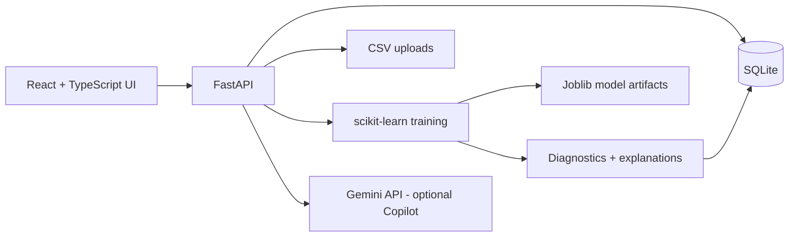
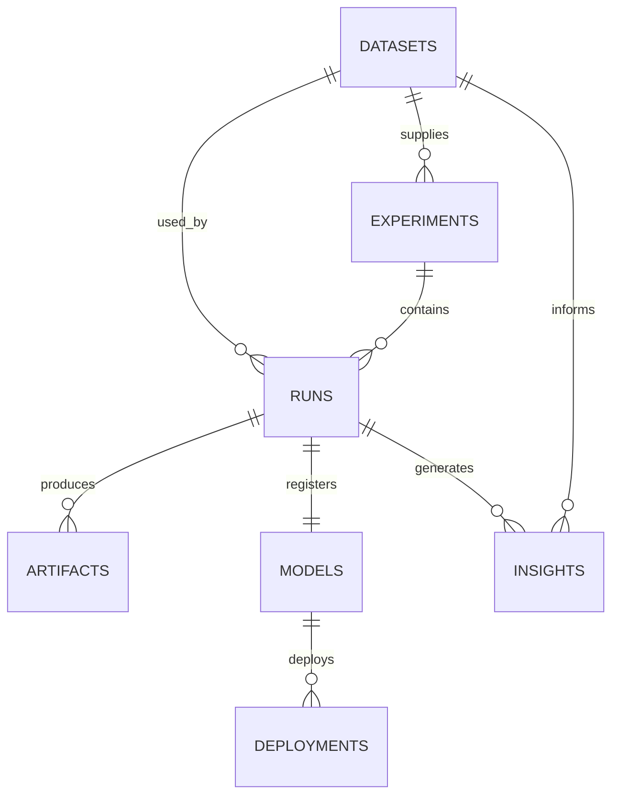

# Lumen architecture

Lumen is a local-first experiment-intelligence application. The React frontend calls a FastAPI API; the API profiles datasets, trains sklearn models, creates diagnostics and explanations, then persists all records in SQLite.

## Data model

The database tables are `datasets`, `experiments`, `runs`, `artifacts`, `models`, `deployments`, `insights`, and `prompts`.

## Deployment boundary

Docker Compose provides a frontend container, a backend container, health checks, and persistent local storage. The current deployment intentionally uses SQLite; PostgreSQL, Redis, Celery, and MinIO remain a scale-out roadmap rather than active claims.
